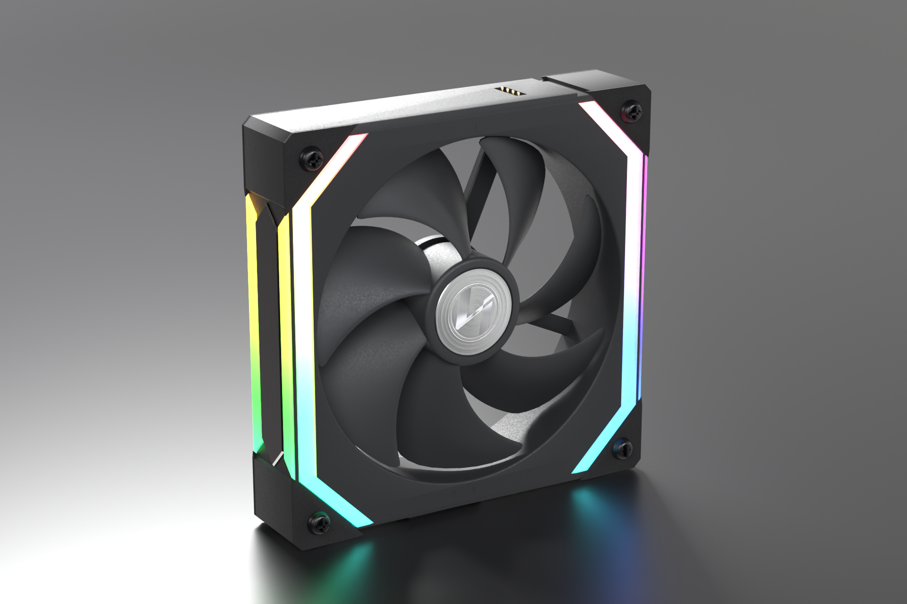
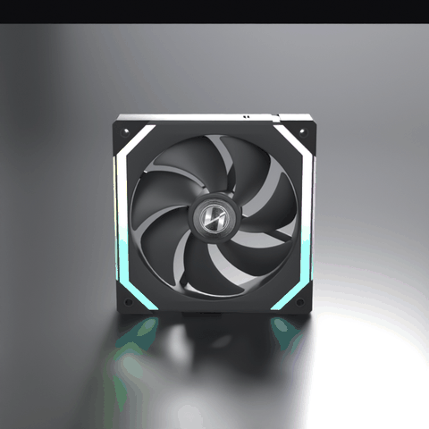

# Lian Li UNI FAN SL120 RGB – 3D model (black, UF-SL120-1B)

**Download everything:** see the [latest release](../../releases/latest) (`LianLi_UNI_FAN_SL120_3D.zip`).





A procedurally built, real-world-scale model of the original UNI FAN SL120 (2020, 25 mm frame, not the V2 or Infinity). It is built for Three.js and React Three Fiber.

## Files

| Path | What it is |
|---|---|
| `glb/LianLi_UNI_FAN_SL120.glb` | Main web asset with embedded textures (4.0 MB, 35,450 triangles, 16 draw calls, 1 animation) |
| `gltf/` | The same model as `.gltf` + `.bin` + `textures/` |
| `blender/LianLi_UNI_FAN_SL120.blend` | Blender 4.5 LTS source file, self-contained (textures and HDRI packed, Cycles studio camera and lights set up; press F12 to render the hero shot). It opens in Blender 4.5 and 5.x. |
| `textures/` | PBR textures: plastic grain normal/ORM, hub cap base/ORM/normal/anisotropy, motor label, RGB emissive ramp, brushed aluminium normal |
| `renders/` | Cycles renders, plus a 360° turntable (`.webp` and `.gif`) |
| `web/index.html` | 360° Three.js viewer with orbit controls, rotor spin, RGB modes and bloom |
| `web/SL120Fan.jsx` | React Three Fiber component |
| `source/` | Scripts that rebuild everything: textures, model, export and renders |

To open the viewer, serve the project folder (for example `npx serve .`) and go to `/web/`.

## Scene hierarchy (glTF node names)

```
SL120
├─ Housing  : Housing_Frame, Housing_CornerPads, Housing_SidePlates_Aluminium, Housing_Contacts_Gold
├─ Motor    : Motor_Housing, Motor_Label, Motor_Wires
├─ Rotor    : Rotor_Blades (hub + 7 blades), Rotor_HubCap      <- pivot exactly on the fan axis
├─ RGB      : RGB_Diffuser_Left, RGB_Diffuser_Right
└─ Screws   : Screw_TL, Screw_TR, Screw_BL, Screw_BR
```

* Units are metres and +Y is up. The front (intake) faces +Z.
* Spin the rotor with `rotor.rotation.z += rpm/60 * 2π * dt`. A positive value turns it counter-clockwise as seen from the front. The GLB also contains a looping `Rotor_Spin` clip at 1 rev/s.
* RGB: the emissive U coordinate is the position around the light loop (0 to 1, continuous around the left and right strips). Scroll `emissiveMap.offset.x` for flowing effects, or remove the map and set `emissive` for a single colour.
* Materials use glTF PBR with KHR_materials_transmission, KHR_materials_ior and KHR_materials_emissive_strength. Khronos glTF-Validator reports 0 errors. The 6 warnings are only "tangents generated at runtime", which is normal for three.js.

## Verified dimensions and sources

* **Lian Li official spec page** (lian-li.com/product/uni-fan-sl): 120 × 120 × 25 mm, 800–1900 RPM, FDB bearing, 12 V fan / 5 V LED.
* **Lian Li official drawings**: 105 mm hole pitch and Ø4.5 mm holes on the original ("prior") SL fan.
* **Lian Li official product photos**, calibrated on the 105 mm hole pitch:
  * 7 blades
  * blade tip Ø ≈ 101 mm and opening Ø ≈ 103.6 mm
  * hub Ø ≈ 32.4 mm and spun-aluminium cap Ø ≈ 26 mm
  * 4 offset struts, one of them a cable channel
  * light strips with 45° ends on both faces
  * corner rubber pads
  * "|" and "◁ ▷" alignment marks
  * bottom feet and tab, and gold contact pins
* **Press release / TechPowerUp**: 32 ARGB LEDs shining through diffusers on each side, diamond-cut aluminium side plates and rubber corner pads.
* **Lian Li logo**: taken from the official `LIAN-LI-LOGO.svg`.
* **Motor label text** (DC 12 V 0.18 A / 800 ~ 1900 RPM / LED 5 V 0.65 A): read from a photo of retail SL120 fans (PC Gamer review). Lian Li's own back photo shows SL140 values.
* **Screws**: the box contains 4 black fan screws (official package photo). They are modelled as 5 × 10 mm self-tapping screws.

## Approximations (not fully verifiable from public sources)

* Exact blade airfoil, camber and axial depth. The front-view outline matches the photo.
* The depth profile of the side wall layers (diffuser bands and aluminium plate) and of the interlock rails and latches.
* Hidden motor internals are not modelled.
* The label font is Liberation Sans, which is metric-compatible with Arial.

The Lian Li name and logo are trademarks of LIAN LI Industrial Co., Ltd. Check your usage rights before publishing them on a commercial site. The HDRI (Poly Haven "Studio Small 09") is CC0.

## Rebuild

```
python3 source/scripts/make_textures.py textures            # needs numpy + Pillow
blender -b --factory-startup -P source/scripts/build_sl120.py -- .
blender -b blender/LianLi_UNI_FAN_SL120.blend -P source/scripts/export_sl120.py -- .
blender -b blender/LianLi_UNI_FAN_SL120.blend -P source/scripts/render_sl120.py -- . stills 96
```
